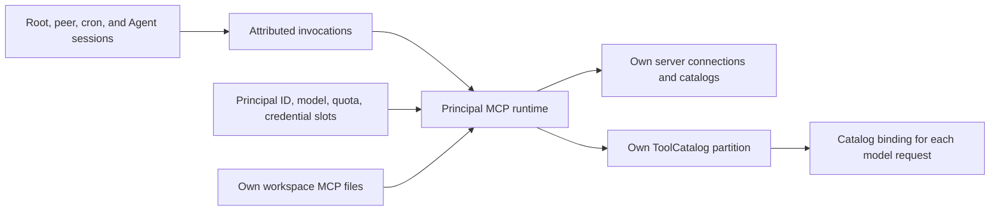

# ADR-075: Principal-owned MCP runtime

- Status: Accepted — implemented on `codex/principal-owned-mcp`
- Date: 2026-10-13
- Refines: ADR-047 workspace MCP, ADR-066 tooling, ADR-069 installation lifetimes,
  ADR-070 exact tool contracts, ADR-072 run admission

## Decision in one paragraph

Each principal owns one MCP runtime, including its connections, credential
bindings, discovered catalogs, and sampling account. All sessions of that
principal share it. Workspace files remain the source of configuration; the
runtime reconciles those files before constructing each model request. A fresh
server connects to discover its schema; a server with a valid cached catalog
may connect lazily on first use. Model requests receive an immutable catalog
binding, and execution checks that binding before sending a call. All discovered
tools use the existing ToolCatalog/ToolDispatcher path. A small `MCP` domain tool
provides diagnostics, recovery, authentication, resources, and prompts without
adding a second configuration-management surface.

## 1. Evidence and lessons from Codex

The source study used the local `~/workspace/ConekoAI/codex` checkout at
`f82e36592278a0a782fb0d0fc97e5fa10e832ac2`, with a clean working tree. These
are observations about that revision, not claims that every public Codex release
has the same implementation.

| Codex source | Observed behavior | Peko adaptation |
|---|---|---|
| `codex-rs/codex-mcp/src/runtime.rs` | A thread owns `McpRuntime`; `ArcSwap` publishes immutable runtime views while bindings retain exact clients/configuration. | The principal owns the service. Session/model-request bindings capture views of that service. |
| `codex-rs/core/src/session/mcp_runtime.rs` | Session inputs project desired configuration; root sessions request eager startup and subagents request `LazyWhenCached`. | Share one principal service instead of creating an MCP runtime for each subagent. |
| `codex-rs/codex-mcp/src/connection_manager.rs` | Reconciliation reuses compatible ready/pending connections. Deferred startup requires usable cached tool definitions, and startup has a shared trigger. | Reuse unchanged principal connections; concurrent sibling calls join one startup operation. Never make a cold server depend on an unknown tool being called. |
| `codex-rs/core/src/session/mcp_refresh.rs` | Invalidation and publication use one gate; cancellation restores an unfulfilled refresh request. | Serialize principal publication, retain pending changes on cancellation, and reject obsolete discovery results. |
| `codex-rs/codex-mcp/src/binding.rs`, `client_tool_catalog.rs` | Bindings retain catalogs and prepared calls; client catalog revisions detect stale calls and coordinate publication with executing calls. | Bind the advertised schema to execution and prevent endpoint/schema substitution during refresh. |
| `codex-rs/codex-mcp/src/tool_catalog_cache.rs` | A bounded, expiring process cache keys tools by transport/environment identity. It declines cache reuse for some dynamic/authenticated identities and rejects older fetch generations. | Use a principal-local cache with explicit configuration and authorization identity. Cache metadata, never live clients or secret material. |
| `codex-rs/codex-mcp/src/pagination.rs` | Catalog discovery checks page/item limits, repeated cursors, cursor size, and a total deadline. | Discover every supported page; fail explicitly on protocol/resource limits instead of publishing a silently truncated catalog. |
| `codex-rs/rmcp-client/src/rmcp_client.rs` | The transport layer uses `rmcp`, supports stdio and Streamable HTTP, manages OAuth state, cancellation, and session recovery. | Keep Peko's ownership/accounting layer; adopt an SDK-backed protocol adapter rather than expanding the handwritten stack. |

The [official MCP documentation](https://learn.chatgpt.com/docs/extend/mcp?surface=cli)
is supplementary product documentation; the source paths above establish the
implementation details.

Do not copy Codex's thread lifetime, plugin/App routing, tool exposure/search
policies, credential environment-variable conventions, or approval machinery.
Peko's principal owns resources; its sessions organize conversations. ADR-066
and ADR-070 keep registered tools unfiltered. Protocol readiness and resource
ownership are separate from capability grants.

## 2. Problems in the previous Peko integration

1. `principal/context.rs::install_principal_tool_bag` loads workspace configs,
   then registers **every** binding from the process-global manager under the
   caller's principal. Servers from another principal can become callable, and
   globally keyed server names collide.
2. `McpManager::add_server_config` creates a stopped, unhealthy server with no
   tools. `get_tool_bindings` excludes it. The proxy's lazy-start behavior cannot
   discover the first tool. Cached names in the prompt do not fix missing
   executable bindings.
3. `ensure_principal_tool_bag` scans only before inserting the principal into
   `installed_principals`. Edits, additions, removals, late startup, and dynamic
   tool changes do not reconcile the principal catalog.
4. `workspace.rs::registry_to_mcp_server_config` copies only a subset of JSON
   fields, dropping authentication, environment, reserved parameters, and
   timeout configuration. YAML and JSON do not have equivalent semantics.
5. Sampling resolves a principal ID with `get_by_name`, falling back to an
   unlimited meter. Daemon startup/restart may also bind an unlimited meter.
   `InjectableMcpToolProxy` delegates to `execute` and loses the call context.
6. Protocol APIs for resources/prompts exist, but there is no corresponding
   principal tool surface. The prompt describes capabilities the agent cannot
   directly consume. Reserved-parameter trace logging also prints injected
   values, including vault-backed secrets.

Restarting the daemon or adding another MCP CLI command would leave the ownership
and advertised-schema problems unresolved.

## 3. Ownership and composition



Add `Arc<PrincipalMcpRuntime>` to the principal's stable services, constructed
alongside its quota meter. Root, peer-child, cron, Agent, Workflow, and IPC paths
resolve the same service from the **typed local PrincipalId**. Do not attach it
only to `PrincipalContext`: peer-child construction can bypass that context.

The service receives its dependencies explicitly: owner ID, typed workspace/local
paths, owner-scoped vault access, owner quota meter, current principal model
configuration and resolver. ToolDispatcher supplies audit/context. Tests construct it
with isolated passphrase vaults. No process-global MCP accessor remains.

Connections are identified by `(PrincipalId, ServerId, ConnectionGeneration)`.
Tool registrations remain `(registered_name, PrincipalId)`. Connections are direct
SDK-owned leases inside the principal service, not shared supervisor registry entries. Human
display names and Hub IDs are never credential or connection identities.

Two principals can both install `mcp/github/server.json`, use the same remote URL,
and authenticate as different accounts. Their connections, catalogs, caches,
credential bindings, and callbacks remain independent. One principal's sibling
sessions intentionally share all of these resources. Explicitly using the same
external account does not imply sharing a live connection between principals.

The daemon owns vault storage and the generic background supervisor. Native MCP
uses its own principal startup/retry/health lifecycle and SDK-owned process/HTTP
handles; it does not register bare server names in that supervisor. Stdio process
groups/job objects clean up descendants. Standalone mode uses explicit constructors.

Constructing the service need not start processes. Principal activation or an
explicit tool request materializes it. Stopping one session aborts its requests,
not the principal's shared connections. Principal unload/removal or daemon
shutdown cancels startup, rejects new calls, cancels owner tasks as appropriate,
and drains/shuts down the connections.

## 4. Configuration remains workspace files

The canonical file remains `mcp/<server-id>/server.json`. Add a versioned Peko
schema, normalized into one complete typed configuration. The directory ID is
the stable local server identity; tool methods retain their exact names.

Native configuration example:

```json
{
  "schema_version": 1,
  "transport": {
    "type": "stdio",
    "command": "python3",
    "args": ["server.py"]
  },
  "cwd": ".",
  "env": {
    "SERVICE_TOKEN": { "credential": "api_token" }
  },
  "startup": "auto",
  "startup_timeout_ms": 30000,
  "tool_timeout_ms": null,
  "reserved_parameters": {
    "principal_id": { "source": "runtime", "field": "principal_id" },
    "session_id": { "source": "runtime", "field": "session_id" }
  }
}
```

For HTTP, transport is `{ "type": "streamable_http", "url": "https://example.com/mcp" }`
with top-level `auth: { "type": "bearer", "credential": "api_token" }`, or an
OAuth configuration specifying nonsecret client/resource/scope settings. Header
and environment values accept either `{ "value": "nonsecret" }` or a local
credential slot. Relative `cwd` resolves against the manifest's directory; it
never defaults to the daemon's cwd. Process startup receives the existing minimal
process environment plus explicitly configured values, not provider keys or the
daemon's unrestricted environment.

Supported fields include transport, cwd, environment, headers, authentication,
startup, startup/tool timeouts, health/restart settings, reserved parameters, and
optional sampling model/output limits. Reject unknown native fields and invalid
transport-specific combinations with file/field diagnostics. A missing required secret is an error,
not a null injection or an anonymous connection attempt. `tool_timeout_ms: null`
means no additional MCP deadline; dispatcher background receipts do not kill the
request. Startup/discovery still have bounded deadlines.

Keep explicit compatibility readers for the existing JSON transport object and
single-entry `manifest.yaml` format. Both feed the same normalizer and preserve
every supported field. Reject ambiguous multiple-server YAML, duplicate
definitions, and unsupported legacy fields with migration guidance; do not
silently select the first map entry. Migration preserves configured server/tool
names; legacy directories whose IDs disagree are renamed explicitly rather than
silently changing callable names. Flat legacy layouts can be read during this
transition, with deterministic IDs and duplicate checks.

There is no new `install/add/remove/configure` tool or MCP management CLI tree.
`Write`/`Edit` and ordinary filesystem operations manage configuration and server
dependencies. The runtime does not run package installation on its own.

## 5. Credentials are principal resources

A manifest references a **local slot**, not an arbitrary vault namespace or raw
credential ID. The service expands it to an owner/server-qualified namespace,
for example `mcp:principal:<local-id>:<server-id>`. The existing operator
`peko credential set <namespace> <slot> --kind api_key` can provision it without
placing secret material in the manifest. Principals cannot select another
principal's slot by altering arguments, reserved-parameter definitions, or
headers. Existing unscoped MCP credentials require explicit operator migration;
there is no automatic fallback to a globally named token.

Resolve secrets at transport/call preparation through the bound vault facade.
Keep secret values out of debug formatting, schemas, caches, prompts, traces,
errors, and executable inventories. Reserved-parameter logs record names and
sources, never resolved values. Runtime identity injection rejects attempted
caller overrides and missing context; it preserves `execute_with_context` all
the way to execution.

These are native service/credential ownership guarantees. Arbitrary stdio
executables retain the existing process trust model used by Bash; an owner-bound
MCP client is not an OS filesystem sandbox. Remote servers still enforce their
own account/resource authorization.

OAuth authorization binds state/PKCE and callbacks to the owner, server,
endpoint/resource, and authorization generation. Authentication completion
invalidates only that principal/server. Requests never inherit the terminal
user's Hub login or another principal's external login. Token replacement, including
routine OAuth refresh, changes the credential revision and invalidates the next
connection/cache generation. Refresh is serialized per server credential binding.

The workspace snapshot includes definitions and local slot names, not ordinary
MCP token material or the local catalog cache. Import requires provisioning or
reauthorization in the destination runtime. Existing signing-key snapshot rules
are unaffected. A future encrypted account-transfer feature is separate work.

## 6. Discovery and startup

Separate connection state from catalog state:

- Published connection state: `dormant`, `starting`, `ready`, `failed`, `invalid_config`;
  authentication/backoff reasons appear in diagnostics. Retired generations reject
  admission but retain started calls until completion or owner teardown.
- Catalog: `unknown`, `cached`, `fresh`, internally bound to configuration/credential
  identity and exact descriptors. Failed discovery retracts inventory.

An offline server may have a valid cached schema and executable proxies. A live
connection may legitimately have zero tools and offer only resources/prompts.
Do not equate `running == true` with having a catalog.

`startup: auto` is the default: use a valid cached catalog when present; otherwise
connect, initialize, and discover before advertising native tools. `eager`
connects on principal activation even with a cache. `lazy` defers the connection
when a valid catalog exists; requesting an uncached catalog still triggers its
first discovery. Lazy startup never invents a schema or requires the agent to
guess an unknown method.

Start multiple servers concurrently under a bounded per-principal startup pool
(initially four). A first catalog assembly waits within a shared 30-second
startup/discovery budget, rather than a full timeout per server sequentially.
Failures do not fail principal boot or unrelated tools. Unresolved servers remain
in `MCP status` with a precise reason; cold servers have no fabricated bindings.
Servers completing later publish their real catalogs for the next iteration.

Each connection generation has one startup future. Concurrent sibling calls
await it without holding catalog locks. Cancelling one waiter does not cancel
another session's startup. Owner shutdown or replacement cancels the generation.
Successful discovery fetches all pages with bounded total time, page/item/byte
limits, and repeated-cursor detection. Exceeding those limits fails discovery
explicitly; it does not publish an incomplete inventory as a complete one.

Initially cache catalogs in the principal's **local runtime data**, outside the
portable workspace. Cache identity includes owner ID, server ID, normalized
transport/cwd/configuration digest, authorization revisions and cache-format
version. Live reconnect negotiates protocol/capabilities before reuse. Use an initial 30-minute TTL
for reuse across activation; active connections use fresh catalogs. Cache entries
contain full descriptors, not just names. Configuration changes or uncertain
authorization identity invalidate reuse. An old bare-name `.peko-tools.*.json`
file cannot establish a new service's callable authority.

On a call using cached metadata, establish the connection, fetch live descriptors,
and verify the selected descriptor against the advertised one before sending
`tools/call`. If it changed or disappeared, return `McpCatalogChanged`; rebuild
the model catalog on the next iteration. Offline/unavailable tools return normal
tool errors and remain recoverable through status/retry. Metadata cache failures
never turn into unlimited sampling or credential fallbacks.

## 7. Reconciliation and consistent calls

Before every model request, reconcile the principal's workspace manifests and
authorization revisions. Read bounded manifest content and compare normalized
digests; a directory mtime alone cannot detect an edit inside a subdirectory.
Filesystem watching can mark the service dirty, but is an optimization, not the
only correctness mechanism. `MCP refresh` forces a scan and live catalog fetch.

Apply changes per server: add a generation for new definitions, reuse an unchanged
connection, reconnect for connection/credential changes, and publish only new
metadata for call-time settings such as timeout. A deleted or invalid definition
immediately becomes unavailable to new calls once observed. Keep its diagnostics,
not a silently executable last-good configuration. Other valid servers continue.
Discovery completion publishes only if its owner/server/configuration generation
is still current. A late result cannot resurrect a removed server.

Consume supported tool/resource/prompt list-change notifications by invalidating
and refetching that server's catalog. For servers without change notifications,
refresh inventory at a bounded interval while active (initially 30 minutes), on
reconnect, and on explicit refresh. Do not claim that model iterations alone
detect arbitrary remote tool changes. Removing a live tool removes its binding;
schema replacement never runs as an alias for the old definition.

Add an atomic MCP-source partition replacement to `ToolCatalog`: publish the
owner's complete new MCP entries and remove obsolete entries in one transaction,
without changing built-ins or another principal's partition. A reader captures
one immutable partition; it cannot observe half of a multi-tool update. Sort the
wire definitions deterministically and preserve exact registered names such as
`mcp__github__search_issues`. Names use ASCII letters/digits/underscores/dashes
and at most 64 bytes, as required by model function APIs. Unsafe, long, or ambiguous
component pairs receive a deterministic digest suffix; duplicate registered names
reject the offending server catalog instead of replacing another method. Map bindings
to exact remote methods without reparsing
untrusted names at execution time. No capability/search/exposure filter is added.

The engine's current `list_tool_definitions -> Vec` and later live lookup are
insufficient to guarantee advertised-schema consistency. Evolve the existing
ToolFunnel catalog method to return definitions plus an opaque, leased catalog
binding. Tool calls from that model request carry the binding through the existing
execution method. Keep these contract types neutral in `peko-engine`; it imports
no root MCP type. This refines the existing seam, rather than adding a global
lookup or a second tool executor. Update API_SURFACE when implementing it.

The same catalog binding accompanies prompt-section rendering, so MCP status and
server instructions cannot race ahead of the model request's tool definitions.

A binding pins owner, exact tool definition, reserved-parameter plan, connection
generation, and call settings. Admission checks the current owner/server state:

- A call already admitted keeps its prepared handles until completion, including when
  the dispatcher returns an async receipt. A normal refresh can publish a newer
  view while that call finishes; it does not mutate the old call's destination.
- A not-yet-admitted call against a removed definition, changed endpoint/authorization,
  or incompatible descriptor returns `McpCatalogChanged`/`McpServerRemoved`.
  It must not silently execute on a new destination under the old name.
- Configuration removal drains started calls but rejects new admission. Principal
  removal, explicit credential revocation, and daemon shutdown cancel affected
  calls and dispose of retained generations when their leases end.
  Retired generations cannot start new connections.
- IPC, cron, and Workflow calls that did not originate from a model catalog capture
  the current binding at dispatch. They use the same preparation/validation/audit
  path. Sibling sessions cannot overwrite one another's bindings.

Call admission and generation invalidation share a short synchronization boundary;
network I/O does not hold the global/principal catalog lock. The client may still
reject a method changed remotely between discovery and execution; return that
error. Peko cannot make a remote server's own catalog atomic.

All outbound calls pass through ToolDispatcher once. Keep owner/session/run/call
attribution, workspace hooks, cancellation, progress, normal tool-error semantics,
and background receipts. Do not automatically replay `tools/call` after an
ambiguous disconnect: a remote side effect may already have happened. Reconnect
and metadata discovery may retry with bounded backoff; retrying the business
operation is a new caller decision.

## 8. Principal-facing operational surface

Install one stable, principal-bound `MCP` builtin with exact action schemas:

| Action | Purpose |
|---|---|
| `status` | List own configured servers, paths, state, catalog freshness, tool counts, and sanitized diagnostics; works without any connection. |
| `refresh` | Reconcile files and refresh a named server's catalog, or all own servers. Does not reinstall dependencies or recreate unchanged connections. |
| `reconnect` | Explicitly create a new connection generation for one own server. |
| `authenticate` | Begin that server's OAuth flow and return a user-facing authorization URL/status, never tokens. Return an actionable error when interactive authentication is unavailable. |
| `resources` / `resource_templates` | List a named server's resources/templates with protocol pagination. |
| `read_resource` | Read an exact URI from the named server. |
| `prompts` / `get_prompt` | List or retrieve a named prompt with explicit arguments. |

The server parameter resolves only inside the service's owner. There is no
caller-selectable foreign principal and no generic raw-JSON-RPC escape hatch.
Native MCP methods remain individual tools; `MCP` does not add a duplicate
generic `call` action. These actions use ToolDispatcher like other domain tools.

Tools, resources, templates, and prompts are distinct protocol capabilities.
Resource content and retrieved prompts are returned as tool data. Getting a
prompt does not silently replace the principal's role/system prompt. Preserve
structured results and supported text/image/resource content through adapters;
do not flatten everything into text. Map MCP `isError` to failed tool execution.

Replace the global `mcp_context` renderer with principal-scoped status/instructions
from the same captured view used to assemble the model's tools. Put changing
status in the per-turn runtime context; retain static role text in the frozen
prefix. Report cached/offline tools accurately, and do not list another
principal's servers or suggest unavailable resource APIs. Server instructions
are labeled external integration context, not principal identity/governance.

A principal can write a definition, then call `MCP refresh`, inspect `status`, and
use the discovered native tools on its next model iteration. Ordinary `Write`
followed by the next iteration also works. This is the self-service path; no
daemon restart, installation CLI, or capability grant is required.

## 9. Sampling, callbacks, and run admission

Bind the server-request handler to the immutable owning PrincipalId and the
actual `Arc<QuotaMeter>` at service construction. Never resolve an ID as a name
and never create an unlimited fallback. An intentionally unlimited principal
still has its real meter with unlimited configuration.

Sampling uses the principal's model preference (or explicit per-server sampling
model), model/spec validation, output bound, preflight cost check, and metered
provider/cycle budget. An absent model or unavailable owner is an explicit error.
Do not select the first enabled global model. Reuse these existing model service
primitives without dispatching a fresh agent turn.

Sampling requires an active, attributed outbound operation on the same owned
connection. An idle server request cannot wake a session or create an agent run.
All sampling charges the owner regardless of which sibling started the process.
Use protocol request correlation for session attribution when available; with
multiple outstanding operations and no reliable correlation, record principal/
server attribution with no guessed session. Never use the last caller's context
as connection-global state. Forward only the supplied sampling messages; do not
implicitly export private session history or expose Peko's native tools.

Advertise only callbacks the adapter actually implements. Progress/cancellation
use request-scoped IDs. Elicitation is not advertised; there is no human-frontend bridge in this
implementation and unsupported callbacks receive the SDK protocol error. OAuth completion updates credentials/status without
starting a run. MCP list-change notifications, sampling, and reconnects do not
violate ADR-072's human/cron run-admission rule.

## 10. Implementation and migration

Keep the implementation under `peko-rs/core/src/extensions/mcp/`, with a thin
`tools/builtin/mcp.rs` adapter and wiring in principal services. No new workspace
crate. Generic extension framework code does not import MCP or principal types.
The engine gets only neutral catalog-binding types; leaf/protocol/provider-api
dependency rules remain unchanged.

The implementation is organized in `extensions/mcp/service/{config,client,auth,proxy}`,
with a principal-owned coordinator. It pins the crates.io `rmcp` 3.5.1 client for
stdio and Streamable HTTP; legacy SSE uses the compatibility client, including
advertised POST endpoints and bounded UTF-8 event framing. Global manager/runtime
APIs remain compatibility code, but native principal construction does not install
or enumerate them. The global accessor and MCP reload IPC/client variants are removed.

The neutral `ToolCatalogSnapshot`/`ToolCatalogBinding` contract and
`CatalogBoundTooling` wrapper freeze executable tools and MCP context for each model
request. Atomic owner MCP partitions live in ToolCatalog; invocation still uses the
single dispatcher, hooks, audit, cancellation and background-result path.

Global `mcp.toml` definitions and unscoped credentials require explicit migration to
selected principal workspaces/slots. No automatic cross-principal copy occurs.
DATA_MODEL, API_SURFACE, built-in schemas/inventory, MCP guides and CHANGELOG describe
the implemented contracts. OAuth returns a URL instead of opening a browser; no
frontend elicitation UI is added. No automatic package installation occurs.

## 11. Acceptance tests

Use real in-memory/stdio protocol fixtures and isolated vaults; no external LLM,
Docker, or OS keychain is needed for the main suite. HTTP/OAuth tests use local
fixture servers. Fake provider responses verify actual quota/cost charges.

| Scenario | Required evidence |
|---|---|
| Two principals, same server ID/URL, different secrets | Each receives only its own descriptors and credential-bound effects. Foreign slot/proxy/callback access is rejected. |
| Fresh workspace, no cache | First catalog assembly performs initialization/listing and publishes callable tools. No manual start or guessed method is needed. |
| Valid cached offline catalog | Tools are advertised, sibling calls share one start, and descriptor mismatch prevents `tools/call`. |
| Two sibling sessions | One principal connection, separate invocation/session parameters, correct progress/cancel routing. |
| File add/edit/delete while model or tool call is active | Next model request sees an atomic new catalog; unsent stale calls fail; started calls finish on the original endpoint; late startup cannot resurrect a deleted server. |
| Malformed manifest or duplicate ID | Actionable file/field status, no silent field loss or last-good execution; unrelated servers work. |
| JSON/YAML normalization | Auth/env/timeouts/reserved fields round-trip equivalently; unsupported/multiple legacy definitions fail explicitly. |
| Credential change and OAuth callback | Correct owner/server invalidation, serialized refresh, no cross-account cache reuse, no tokens in diagnostics, schemas, or host-generated auth results. |
| Sampling before/after restart and concurrent calls | Charge the exact owner meter/cost budget; use its model; missing owner/model fails; idle requests never start runs. |
| Paginated discovery and list changes | All valid pages included; duplicate cursors, oversize/incomplete lists and late revisions rejected; removed tools disappear. |
| Resource/prompt-only server | Zero native tools is valid; operational actions retrieve data without injecting it into the principal system prompt. |
| Disconnect after possible remote side effect | No automatic business-operation replay. |
| Timeout/abort/async receipt/principal removal | Request cancellation is scoped; detached handles stay valid until completion; owner teardown cleans up all generations. |
| Snapshot export/import | Definitions/slot names move; tokens/cache do not; destination auth requirement is explicit. |

Run the existing boundary/dependency gates and appropriate fmt/clippy/lib tests
for each implementation slice. Local protocol fixtures validate transport behavior without external accounts;
full interoperability with every third-party server remains outside that evidence.

## 12. Alternatives

An MCP client script run by `Bash`/`Workflow` remains valid for a one-off workflow.
It avoids native schema discovery, but moves connection/auth/retry/result handling
into the script and does not automatically expose individual methods to the model.
It is an alternative access path, not the foundation of native integration.

A process-global pool filtered by principal is insufficient if its keys,
credential bindings, callbacks, or startup meters remain global. It saves some
connections at the expense of a much harder ownership contract. Default to one
principal's connections; optimize only after evidence justifies a proven-safe pool.

A runtime per session follows Codex's owning-chat model but duplicates connections
and external account state across Peko's standing children, cron, and subagents.
That contradicts the principal's resource lifetime. Use session-scoped calls over
principal-scoped services instead.
